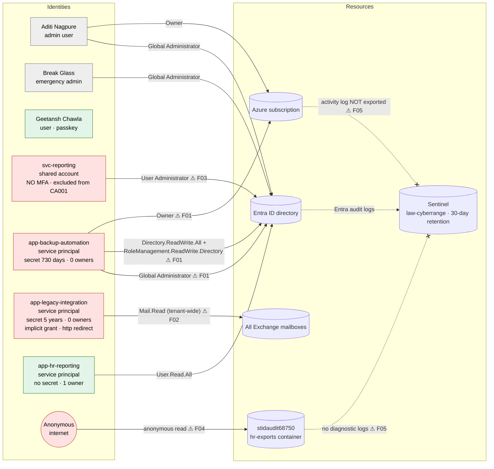
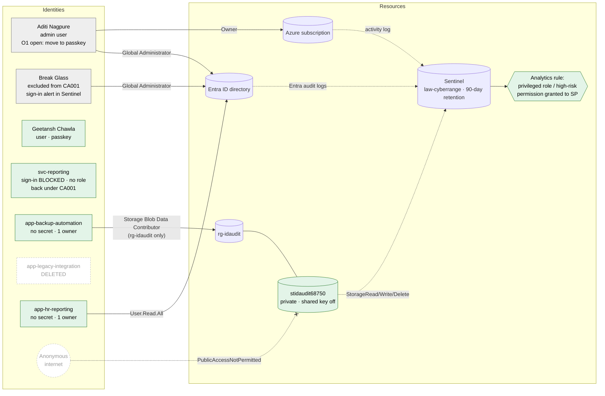

# Access Map — Before and After Remediation

> **SIMULATED ASSESSMENT** — tenant `AditiSecurityLab.onmicrosoft.com`. Red = finding, green = least-privilege / remediated, grey = accepted or reviewed.

## Before (as planted, 15 Nov 2026 — audit checks A01–A08)

## After (remediated and verified, 15 Nov 2026 — checks V01–V05, D01–D03)

## What changed

| Path | Before | After |
|---|---|---|
| app-backup-automation → Entra | Global Admin + directory and role write | none |
| app-backup-automation → Azure | Owner on whole subscription | Storage Blob Data Contributor on one resource group |
| app-backup-automation credential | 730-day secret, no owner | no secret, 1 named owner |
| app-legacy-integration → mailboxes | Mail.Read on every mailbox | app deleted |
| svc-reporting → Entra | User Administrator, no MFA | no role, sign-in blocked, MFA enforced |
| Internet → hr-exports | anonymous read | blocked (PublicAccessNotPermitted) |
| Azure + storage → Sentinel | not logged, 30-day retention | logged, 90-day retention, detection rule live |
